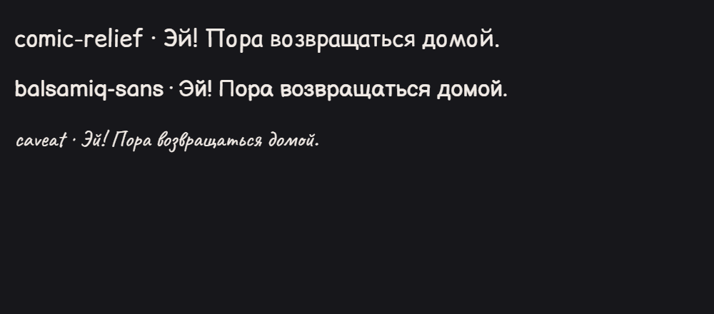

# Google translation diagnostic · 2026-11-05

These are real calls through the deployed Oracle Google gateway, using existing
server-owned credentials. Images are two generated 700×1000 English dialogue
samples, not a downloaded chapter. No credential values are included.

| Request | Requested slot | Effective slot | HTTP | Wall time |
| --- | ---: | ---: | ---: | ---: |
| Two-page translation | 1 | 1 | 200 | 1.412 s |
| Two-page translation | 2 | 2 | 200 | 6.243 s |
| Two-page translation after a provider failure | 3 | 1 | 200 | 8.966 s |
| Final language probe, production prompt + object schema | 1 | 1 | 200 | 3.487 s |

An earlier slot-3 language trial received Google HTTP 503 after 7.022 s, with a
provider cooldown of about six seconds. The next request was routed to an available
slot. Slots 1 and 2 returned HTTP 200. A preliminary unstructured trial produced
translation-shaped JSON rather than the requested object; the released Gemini
probe explicitly requests an object schema and validates dialogue percentages.
The final probe returned English 100%, no SFX, hasDialogue=true, STOP. It used
2,407 input tokens and 110 output tokens on gemini-3.5-flash-lite.

This small sample verifies the gateway, parallel keys and request transport. It
does not establish the latency/quality of full dense pages, detector inference,
inpainting, or CPU models. The observed provider 503 is transient availability,
not evidence that a saved API key expired. The application does not repeat a
failed language probe automatically. It can be cancelled and has a 15-second
client deadline. Source-language selection can disable it.

Language detection samples up to two pages, reduces them to max 1,280 pixels on
the long side, separates dialogue from SFX and retains the user's language when
confidence is low. Only language proportions/timing stay in component memory;
images and keys are not added to settings. Successful results are reused while
that chapter remains open, and changing credentials invalidates the result.

Typography adds OFL Balsamiq Sans (regular/bold) and Caveat, with verified Cyrillic
coverage and local WOFF2 subsets. Balsamiq bold handles strong rounded shouts;
Caveat handles loose handwritten notes. Ordinary dialogue remains Comic Relief.
Font changes invalidate rendered images, while translated JSON can be reused.

Sources: [Gemini structured output](https://ai.google.dev/gemini-api/docs/structured-output),
[font author](https://github.com/balsamiq/balsamiqsans),
[Caveat distribution](https://github.com/google/fonts/tree/main/ofl/caveat),
[lettering discussion](https://forum.comicsnews.org/viewtopic.php?f=2&t=38).

Browser contracts use fixture API responses and real canvas/FontFace decoding.
They are separate from the live gateway measurements above.

