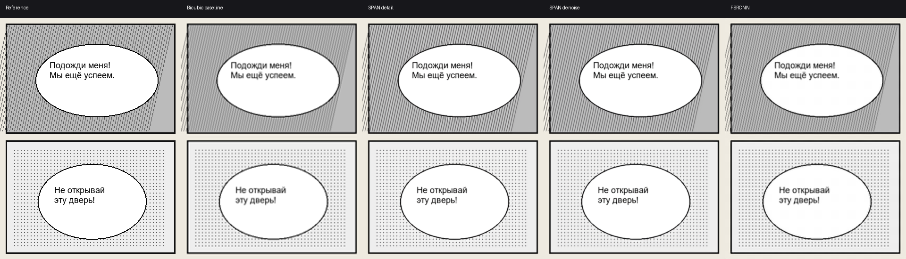
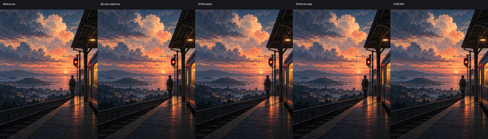

# CPU upscaler comparison · 2026-11-05

Real ONNX Runtime CPUExecutionProvider, one intra/inter-op thread, no GPU.
Input 192×256, output 384×512; first inference and median of two warm inferences.
The line-art page is a controlled generated target with Russian text, thin lines
and halftone dots. The colour reference is the project's existing anime-style
screen placeholder. Both references were downsampled with bicubic filtering.
These are controlled examples, not a representative manga benchmark dataset.

| Sample | Model | Load ms | Cold ms | Warm ms | PSNR dB |
| --- | --- | ---: | ---: | ---: | ---: |
| manga-lines | detail | 8.4 | 452.4 | 472.7 | 22.18 |
| manga-lines | denoise | 6.2 | 452.0 | 457.6 | 21.8 |
| manga-lines | fast | 2.3 | 32.8 | 25.3 | 19.88 |
| anime-background | detail | 6.3 | 484.1 | 462.7 | 33.32 |
| anime-background | denoise | 6.2 | 461.3 | 460.9 | 33.01 |
| anime-background | fast | 2.6 | 35.3 | 27.3 | 32.46 |

PSNR compares reconstruction with the known reference; higher is closer on this
sample, not a universal artistic quality score. Detail retains more fine texture;
denoise smooths noise and can remove intentional halftones. FSRCNN is much faster
but reconstructs fine strokes less faithfully. No interpolation is reported as
neural inference: each neural column actually ran its trained ONNX network.
Bicubic is shown separately as a non-neural baseline.

Columns: known reference, bicubic baseline, SPAN detail, SPAN denoise, FSRCNN.
All images can be opened individually in the adjacent asset directory.

The actual browser worker also ran every hash-verified model on CPU/WASM at
96×128: detail 335 ms, denoise 318 ms, FSRCNN 8 ms in that run. Browser worker
startup/download is separate. Native/browser figures differ in runtime and input
size; they must not be compared directly. Large pages/slow phones can exceed
2–3 seconds. Profiles cap inference dimensions and keep a sufficiently large
original rather than silently downscaling it. Translation overlays are not fed
through this enhancement. Public enhanced backgrounds may cache in CacheStorage;
private reader pages remain in memory. Model files cache by SHA-256.

SPAN profiles are IllustrationJaNai colour models, CC-BY-NC-4.0, not the specialized
grayscale MangaJaNai ESRGAN model. FSRCNN is general luminance SR, Apache-2.0.
See reader-models manifests and THIRD_PARTY.md for complete attribution.
